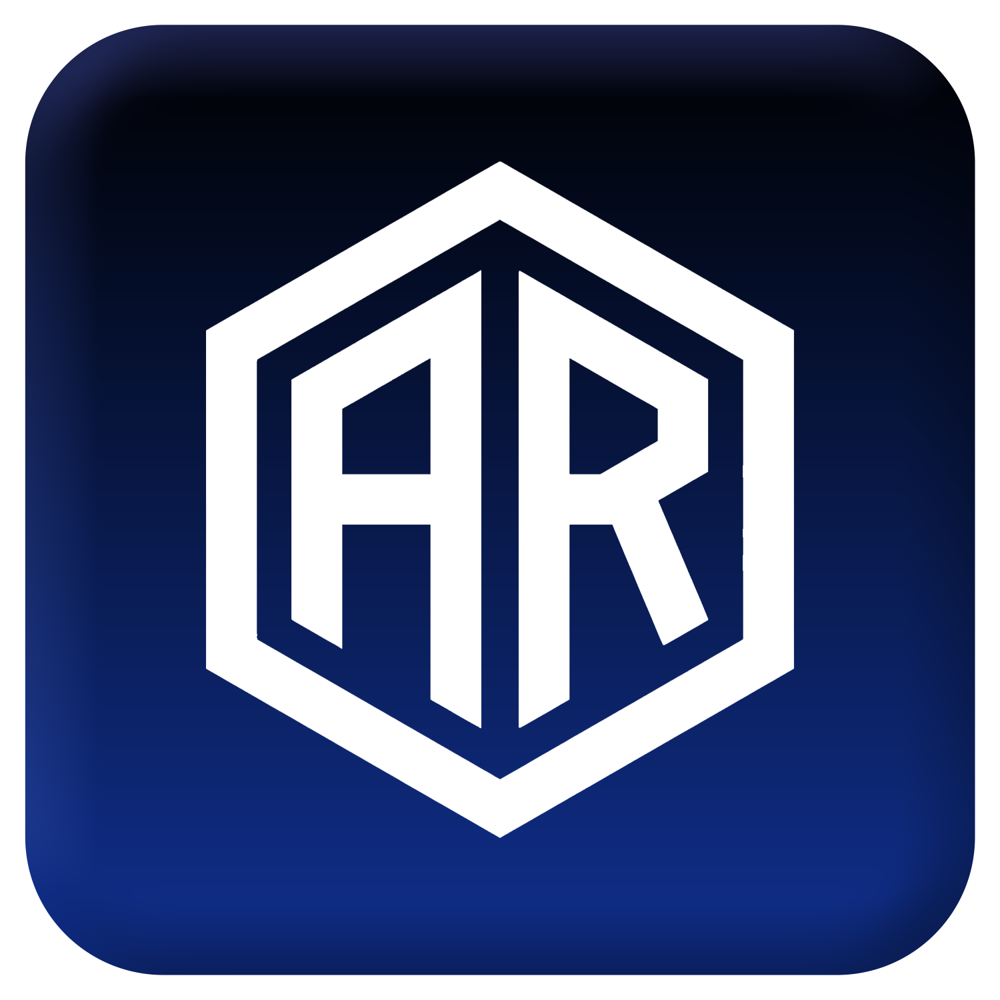

<div align="center">


# AimRust

**A lightning-fast, minimalist, and highly responsive FPS aim trainer built from the ground up in Rust.**

[](https://www.rust-lang.org/)
[](https://bevyengine.org/)
[](https://github.com/vladfaust/bevy_egui)
[](#license)
[](packaging/)

</div>

---

## 📌 Overview

**AimRust** is a native, lightweight 3D aim trainer crafted for competitive FPS players who value sub-millisecond input responsiveness, low latency, and zero bloat. Built directly on top of the **Bevy 0.20.1** game engine and styled with **egui**, AimRust provides an esports-grade training ground without the overhead of heavy third-party launchers or web runtimes.

---

## 📸 Screenshots

<div align="center">
  
</div>

---

## ✨ Features

- **🎯 14 Comprehensive Training Scenarios**:
  - **Flicking & Speed**: *Gridshot*, *Sixshot*, *Spidershot*, *Flick*, *Multishot Ultimate*, *Micro Adjust*, *Headshot Precision*.
  - **Tracking**: *Tracking Follow* (continuous beam tracking) and *Tracking Shoot* (reactive timing click-tracking).
  - **360° & Spatial Awareness**: *Cylinder Micro* (cylindrical arena target clicks), *Peek Exercise* (strafing and angle holding), *Superflicks* (multi-target chamber clearing with incoming projectile turrets), *VCT TenZ Arena*.
  - **Free Sandbox**: Infinite practice with customizable target sizes, ranges, and target count.

- **⚡ Low-Latency Input & Physics**:
  - Direct raw mouse input polling via `bevy_winit`.
  - Analytical sphere/AABB raycasting with hit-zone precision and reaction-time tracking ($TTK$).
  - Zero-allocation runtime tick loops and pre-allocated geometry mesh instances.

- **🎛️ Deep Customization**:
  - **Crosshairs**: Full control over style (Cross, Dot, Circle), size, thickness, gap, outline, dot, and color schemes.
  - **Sensitivity Matching**: Precise sensitivity multipliers for Valorant, CS2, Overwatch 2, Apex Legends, and Source engines.
  - **Field of View (FOV)**: Configurable horizontal and vertical FOV scalers, with optional Aim Down Sights (ADS) mechanics and weapon models.
  - **Audio Engine**: Embedded low-latency PCM synth audio for immediate hit and miss feedback, complete with independent volume sliders.

- **📊 Session Analytics & Performance Tracking**:
  - Real-time HUD displaying score, round timer, accuracy, hits, misses, and streak.
  - End-of-round performance screen with accuracy graphs, TTK breakdown, and local high-score persistence.

- **🌐 Zero-Dependency Discord Rich Presence**:
  - Integrated asynchronous IPC worker showing real-time training tasks, active score, and timestamps directly on Discord.

- **📦 Portable Mode**:
  - Drop a `portable.ini` file next to the binary or AppImage to store all settings and scores in a localized `AimRust.config/` folder without touching `~/.config`.

---

## 🛠️ Technologies Used

- **Language**: [Rust](https://www.rust-lang.org/) (2024 Edition)
- **Game Engine**: [Bevy](https://bevyengine.org/) `0.20.1` (Modular ECS architecture, message-based event passing, modern renderer)
- **GUI Framework**: [egui](https://github.com/emilk/egui) / [bevy_egui](https://github.com/vladfaust/bevy_egui) `0.43.1` (Immediate mode UI)
- **Data & Serialization**: [serde](https://serde.rs/) & [toml](https://github.com/toml-rs/toml)
- **Windowing & Display**: Wayland and X11 native backends via `winit`
- **Packaging**: AppImage, FreeDesktop Desktop specification, AppStream metadata

---

## 🚀 Getting Started

### Prerequisites

Ensure you have Rust and Cargo installed (recommended: `stable` with Rust 2024 edition support):

```bash
curl --proto '=https' --tlsv1.2 -sSf https://sh.rustup.rs | sh
```

Install standard Linux development dependencies (Debian/Ubuntu example):

```bash
sudo apt-get update
sudo apt-get install -y \
    pkg-config \
    libx11-dev \
    libasound2-dev \
    libudev-dev \
    libwayland-dev \
    libxkbcommon-dev
```

### Building & Running

1. **Clone the repository**:
   ```bash
   git clone https://github.com/MichaelX17/AimRust.git
   cd AimRust
   ```

2. **Run in development mode**:
   ```bash
   cargo run
   ```

3. **Build optimized release binary**:
   ```bash
   cargo build --release
   ```
   The compiled binary will be placed at `target/release/AimRust`.

4. **Run tests & linters**:
   ```bash
   cargo test
   cargo clippy --all-targets -- -D warnings
   ```

---

## 📦 Linux Packaging & AppImage

To bundle AimRust as a standalone, portable Linux AppImage:

```bash
cd packaging
./build-appimage.sh
```

For more details on AppImage distribution and AppStream metadata, see [packaging/README.md](packaging/README.md).

---

## 🎮 Controls

| Action | Default Key / Input |
| :--- | :--- |
| **Look / Aim** | Mouse Move |
| **Shoot / Select** | `Left Mouse Button` |
| **Aim Down Sights (ADS)** | `Right Mouse Button` |
| **Pause / Menu** | `Escape` |
| **Restart Task** | `R` |

---

## 📄 License

Dual-licensed under either of:

- Apache License, Version 2.0 ([LICENSE-APACHE](LICENSE-APACHE) or http://www.apache.org/licenses/LICENSE-2.0)
- MIT license ([LICENSE-MIT](LICENSE-MIT) or http://opensource.org/licenses/MIT)

at your option.
